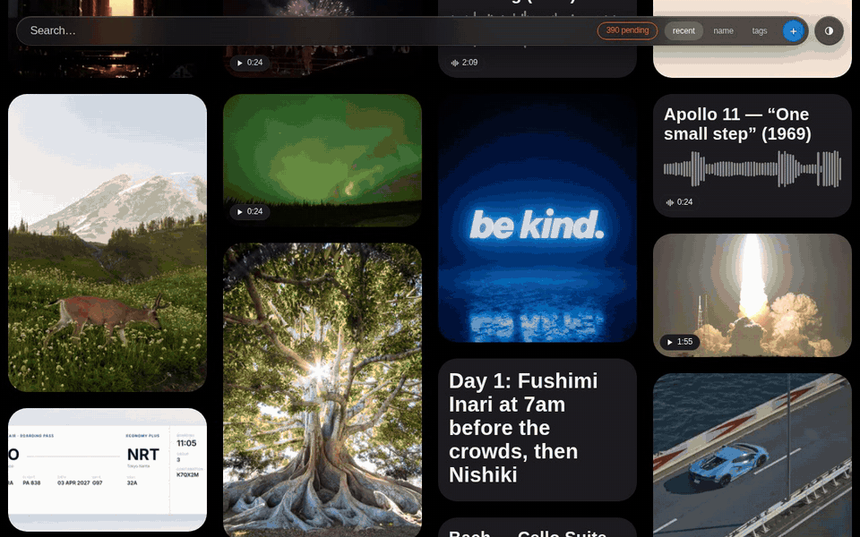
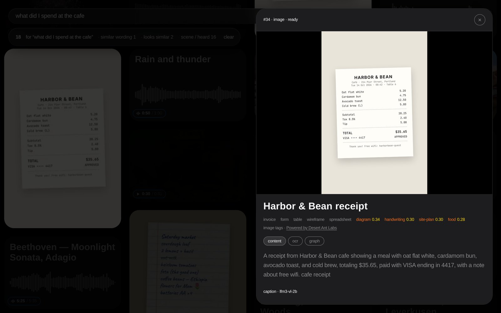

# ZetaDB

### Everything you've ever saved. Found in a moment.

Screenshots, photos, notes, recordings and video, in one search, on your own machine.

 

<picture>
  <source media="(prefers-color-scheme: dark)" srcset="docs/media/library-dark.jpg">
  <source media="(prefers-color-scheme: light)" srcset="docs/media/library-light.jpg">
  
</picture>

 

## It finds the moment.

A two-hour recording isn't one thing, and ZetaDB doesn't treat it like one. It listens in
half-minute windows and watches in ten-second scenes, so a search lands on the minute where the
idea was said, or the scene where it was shown. Open the result and it plays from there.

  
   <i>"why we go to the moon"</i> opens a 17-minute speech at 8:20, where it's said.

  
   <i>"a dragon"</i> opens a 15-minute film at 5:20, where it flies.

## One search. Every kind of file.

One model understands pictures, text, sound and video the same way, so whatever you remember,
ZetaDB finds it in whatever form you saved it. The best answers come first, and the rest fade
back by how well they match.

  
   <i>"sunset over the city"</i>: the photographs, a fireworks clip at 0:20, and quieter matches fading back.

## It reads what you capture.

Screenshots, receipts and whiteboards are read word for word, so a phone number, an error message
or an invoice total is as searchable as a sentence. Every image is described in plain language,
and the people, dates, links and to-dos in your notes are pulled out for you.

  
   <i>"what did I spend at the cafe"</i> finds the receipt, and knows it came to $35.65.

## Tags that know their place.

Images are tagged automatically: *screenshot, receipt, chart, whiteboard, beach, tree*. Each tag
carries how sure it is. Confident tags are applied, unsure ones wait for a quick yes or no, and a
tag you set yourself is never overwritten. Search for *tree* and you get everything tagged tree,
and everything that simply looks like one.

## See how things connect.

Every item shows what it's close to: what looks alike, what says the same thing, what you linked
yourself. Follow the threads across months of saved ideas.

## Drop it in. That's all.

Drag files onto the window, paste a screenshot, type a note, or save into a watched folder. New
things appear in a second and fill in as they're understood.

## Private by design.

Every model runs on your computer: reading, tagging, describing, searching. Nothing is uploaded.
It's built to fit a laptop's 6 GB graphics card.

 

| Notes · Images · Audio · Video | Finds the exact moment | Reads text in images |
| :---: | :---: | :---: |
| **Calibrated tags, human-approved** | **Runs entirely on your machine** | **Light & dark** |

 

**[Get started →](docs/SETUP.md)**  &nbsp;·&nbsp;  [Try the demo library](docs/DEMO.md)  &nbsp;·&nbsp;  [How it works](spec.md)

 

---

#### Credits

- **Embeddings:** [EmbeddingGemma 2](https://huggingface.co/google/embeddinggemma-2) by Google DeepMind
- **Image tags:** [Eye](https://huggingface.co/desert-ant-labs/eye), used with permission — Powered by [Desert Ant Labs](https://desertant.com)
- **Text in images:** [PP-OCRv6](https://huggingface.co/PaddlePaddle) by PaddlePaddle
- **Descriptions:** [LFM3-VL](https://www.liquid.ai) by Liquid AI, via [llama.cpp](https://github.com/ggml-org/llama.cpp)
- **Extraction:** [Needle](https://github.com/cactus-compute/needle) by Cactus
- **Search:** [SQLite](https://sqlite.org), [sqlite-vec](https://github.com/asg017/sqlite-vec)
- **Runtime:** [ONNX Runtime](https://onnxruntime.ai) with TensorRT, [FFmpeg](https://ffmpeg.org)
- **Interface:** [Svelte](https://svelte.dev), [FastAPI](https://fastapi.tiangolo.com)
- **Demo library:** photos from [Unsplash](https://unsplash.com); *Sintel* and *Big Buck Bunny* © Blender Foundation, [CC BY 3.0](https://creativecommons.org/licenses/by/3.0/); recordings and clips from [Wikimedia Commons](https://commons.wikimedia.org). Every source and licence is listed in [docs/DEMO.md](docs/DEMO.md).
