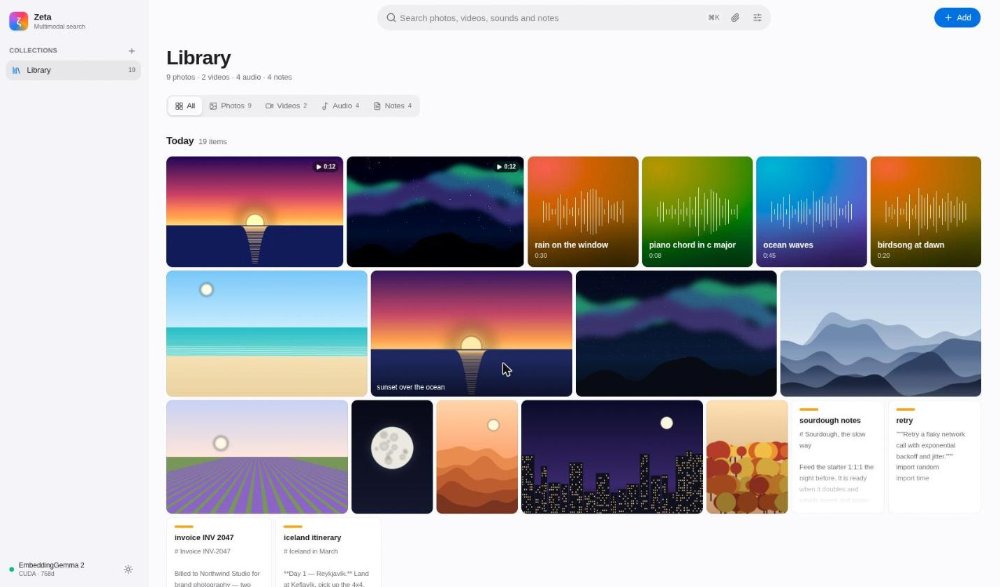
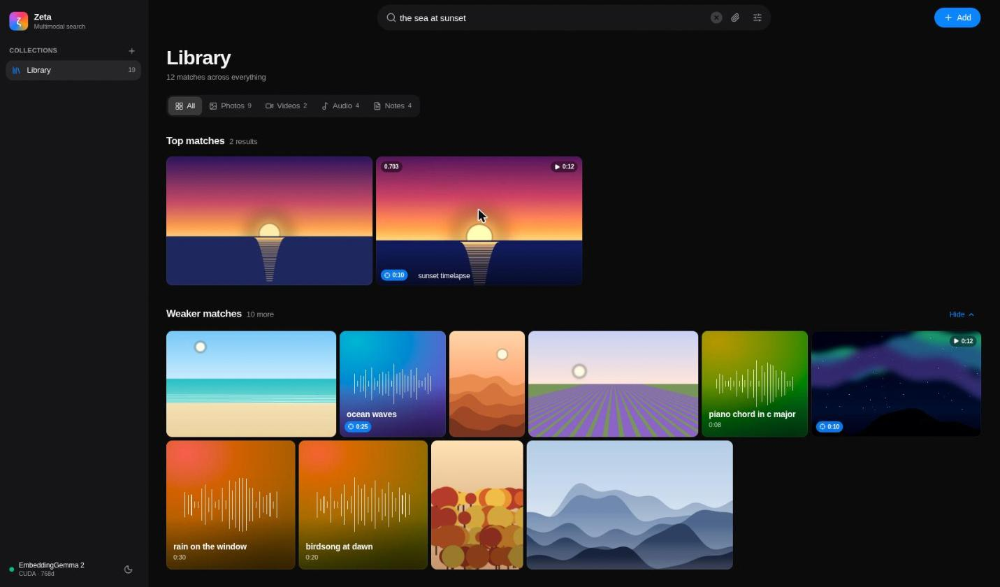

# Zeta

### Search everything. Just describe it.

Photos, videos, music and notes, in one search, on your own machine.

 

 

## One search. Every kind of file.

Type *"the sea at sunset"* and Zeta brings back the photo, the timelapse you shot, and the recording of the waves. A single model understands pictures, sound, video and text in the same way, so whatever you're thinking of, Zeta finds it in any form.

## It finds the moment.

Zeta doesn't stop at the file. It points to **0:10** in the video where the sun meets the water, **0:25** in the recording where the waves roll in, and the exact paragraph in a 40-page document. Open a result and it starts right there.

## Ask it like you'd ask a person.

*"How often should I feed my starter?"* finds the answer in your notes. *"Retry with exponential backoff"* finds the function in your code. *"INV-2047"* finds the invoice. Zeta knows a question from a search, prose from code, and a name from a description.

## Search with anything.

Drop a photo onto the window to find others like it. Drop a song to find the sound. Or mix a picture and a few words: *this, but at night.*

## Private by design.

Everything runs on your computer: the model, the index and your files. Nothing is ever uploaded, and after a one-time model download it works completely offline.

## Beautifully fast.

A grid that fits every photo perfectly, videos that play as you hover, and a viewer that opens with a single fluid motion. It indexes hundreds of photos, songs and documents a minute on a laptop GPU, and it has light and dark modes and a ⌘K palette.

 

| Photos · Videos · Audio · Notes · Code | Finds the exact moment | Words, files, or both |
| :---: | :---: | :---: |
| **Fair results across every kind of media** | **Runs entirely on your machine** | **Light & dark** |

 

**[Get started →](docs/SETUP.md)**  &nbsp;·&nbsp;  [How it works](docs/HOW-IT-WORKS.md)

 

---

#### Credits

- **Model:** [EmbeddingGemma 2](https://huggingface.co/google/embeddinggemma-2) by Google DeepMind, via [Sentence Transformers](https://sbert.net)
- **Search:** [LanceDB](https://lancedb.com)
- **Interface:** [shadcn/ui](https://ui.shadcn.com), [Tailwind CSS](https://tailwindcss.com), [Motion](https://motion.dev), [Lucide](https://lucide.dev)
- **Server:** [FastAPI](https://fastapi.tiangolo.com)
- **Media:** [TorchCodec](https://github.com/pytorch/torchcodec), [FFmpeg](https://ffmpeg.org)
